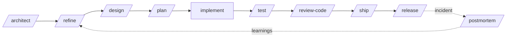

<div align="center">

# 🛠️ Dev Crew

### A complete AI software engineering team for Claude Code

**16 specialist subagents · 28 engineering skills · 18 workflow commands · guardrail hooks**
The whole SDLC, from a vague ticket to a tagged release. Evidence-based, guarded and lean on tokens.

[](LICENSE)
[](https://github.com/mhrezaee/dev-crew/actions/workflows/validate.yml)
[](https://docs.claude.com/en/docs/claude-code/plugins)
[](CONTRIBUTING.md)

</div>

---

## Why?

Claude Code is great at writing code. Software engineering is more than writing code: refining requirements, designing, planning, testing, reviewing, securing, shipping, releasing and handling incidents.

**Dev Crew** gives Claude a team of senior specialists and the checklists real engineering teams use every day, so you get:

- ✅ **Requirements that are testable** before anyone writes code
- ✅ **Designs with trade-offs and ADRs** instead of "just start coding"
- ✅ **Small, ordered plans** that keep the build green
- ✅ **Tests and reviews by default**, not as an afterthought
- ✅ **Security, performance and operability** built in
- ✅ **Language-agnostic**: .NET, Java/Kotlin, TypeScript, Python, Go, Rust, Flutter, Swift and more. Every agent follows *your* codebase's conventions first
- ✅ **Trustable**: answers cite `file:line`, nothing is called "passing" until it ran, and guardrail hooks stop destructive commands and leaked secrets
- ✅ **Lean**: about 2.7k tokens of always-on context; the 18 workflows cost nothing until you type them

## ⚡ Quick start

### Option 1: Claude Code plugin (recommended)

```bash
# inside Claude Code
/plugin marketplace add mhrezaee/dev-crew
/plugin install dev-crew@dev-crew
```

### Option 2: install script (copies into `~/.claude`)

```bash
git clone https://github.com/mhrezaee/dev-crew.git
cd dev-crew
./install.sh            # macOS / Linux / Git Bash
# or
./install.ps1           # Windows PowerShell
```

Use `--project` / `-Project` to install into the current repository's `.claude/` folder instead, so the whole team gets it via git.

> The guardrail hooks are only active with the **plugin** install (Option 1). The scripts copy agents and skills only.

### Try it

```
/onboard                         # understand the repo you're in
/architect                       # choose the right architecture, write blueprint + ADRs
/feature Users can export their bookings as CSV
/fix-bug NullReferenceException in InvoiceService.Calculate when discount is null
/review-code main
/ship PAY-142
/standup
```

## 🔄 The SDLC, covered



## 🏛️ An architect that decides, not just suggests

Run `/architect` and the `solution-architect` works like a senior architect would. It never picks microservices or DDD because they're trendy.

1. **Collects evidence** from your code (or your product vision) and asks at most 5 questions.
2. **Scores 11 drivers**: domain complexity, team scale, deployability, scale heterogeneity, ops maturity, consistency, integration intensity, read/write asymmetry, audit needs, uncertainty, workload shape.
3. **Decides at every level**, with the rejected alternatives written down:

| Level | Options it chooses between |
|---|---|
| System | Modular monolith (default) · layered monolith · microservices · serverless · event-driven |
| Domain | DDD strategic design: subdomains, bounded contexts, context map |
| Code | Layered · vertical slice · clean / hexagonal / onion · DDD tactical (core domain only) · CQRS · event sourcing |
| Integration | REST/gRPC · messaging · sagas · outbox/inbox · BFF · API gateway |
| Patterns | GoF + enterprise patterns, **only where a concrete force exists** |
| Practice | TDD · BDD · contract testing · architecture fitness functions |

4. **Checks for red flags** (distributed monolith, DDD ceremony in CRUD code, event sourcing "for flexibility", big-bang rewrites).
5. **Writes** `docs/architecture/blueprint.md` and ADRs, and **enforces the boundaries** with architecture tests (ArchUnit, NetArchTest, dependency-cruiser, import-linter...).

From then on, `/feature`, `tech-lead`, `code-reviewer` and `test-engineer` all follow the blueprint, so the architecture doesn't erode.

## 👥 The crew (subagents)

| Agent | Role | Model · effort |
|---|---|---|
| `product-analyst` | Turns vague requests into user stories + Gherkin acceptance criteria with a readiness score | sonnet · medium |
| `solution-architect` | Picks the right architecture from your project's drivers, writes the Architecture Blueprint + ADRs, designs features to fit it | opus · high |
| `architecture-reviewer` | Finds boundary violations, cycles, misplaced logic and over-engineering, then plans the fix | opus · high |
| `tech-lead` | Ordered, file-level implementation plan with risks | opus · medium |
| `backend-engineer` | APIs, services, jobs, integrations, with tests | sonnet · medium |
| `frontend-engineer` | UI/mobile with all states, a11y, i18n, responsiveness | sonnet · medium |
| `database-engineer` | Schemas, zero-downtime migrations, query tuning | sonnet · high |
| `devops-engineer` | CI/CD, Docker, Kubernetes, IaC, observability | sonnet · medium |
| `test-engineer` | Unit/integration/e2e tests, flaky-test triage | sonnet · medium |
| `code-reviewer` | Prioritised findings, each re-checked and backed by a failure scenario | opus · high |
| `security-auditor` | OWASP, secrets, dependencies, infra misconfig, with each finding marked VERIFIED or ASSUMPTION | opus · high |
| `debugger` | Reproduce → root cause → regression test → minimal fix | opus · high |
| `performance-engineer` | Measure-first optimisation with before/after numbers | opus · high |
| `refactoring-specialist` | Behaviour-preserving refactoring in safe steps | opus · medium |
| `docs-writer` | READMEs, runbooks, API docs, CLAUDE.md, verified against code | sonnet · low |
| `release-manager` | SemVer, changelog, release notes, release checklist | haiku · low |

Claude delegates to them automatically when a task matches, or you can ask directly: *"use the security-auditor on src/auth"*. Each agent **preloads** the skills it needs (for example `code-reviewer` gets the review checklist and secure-coding rules), so it starts with the right knowledge and needs no extra lookups. Each also has a `maxTurns` limit, so a runaway loop can't burn your budget.

## 🧠 Skills (loaded on demand)

| Phase | Skills |
|---|---|
| Trust | `evidence-protocol`: preloaded into every agent (cite file:line, verify before claiming, label assumptions) |
| Requirements | `requirements-refinement`, `bdd` |
| Architecture | `architecture-selection`, `domain-driven-design`, `clean-architecture`, `microservices-patterns`, `design-patterns`, `architecture-decision-records`, `api-design` |
| Build | `clean-code`, `error-handling`, `secure-coding`, `database-migrations` |
| Test | `tdd-workflow`, `writing-tests` |
| Review & debug | `code-review-checklist`, `debugging-playbook`, `refactoring-patterns`, `performance-optimization` |
| Ship & operate | `git-workflow`, `ci-cd-pipelines`, `docker-best-practices`, `observability`, `incident-response`, `dependency-upgrades` |
| Knowledge | `codebase-onboarding`, `technical-documentation` |

Skills use progressive disclosure: only their one-line description sits in context until Claude needs them.

## ⌨️ Commands (workflows)

| Command | What it does |
|---|---|
| `/feature <ticket>` | Full pipeline: refine → design → plan → implement → test → review, with checkpoints |
| `/refine <idea>` | Ticket → user stories, acceptance criteria, open questions, readiness score |
| `/architect [vision]` | Choose the architecture for this project and write the Blueprint + ADRs (add `scaffold` to create the structure) |
| `/architecture-review [path]` | Architecture health check with a step-by-step fix plan |
| `/domain-model <domain>` | DDD session: event storming, bounded contexts, aggregates, glossary |
| `/bdd-spec <story>` | Example mapping → Gherkin feature → step definitions → run |
| `/design <topic>` | Options + recommendation + diagrams + ADR for a single change |
| `/plan <task>` | Small ordered tasks with files, tests and "done when" |
| `/fix-bug <error>` | Reproduce, root-cause, regression test, minimal fix, review |
| `/test [path]` | Fill test gaps for a module or your current changes |
| `/review-code [base]` | Code review + security review in parallel, sorted by severity |
| `/audit-security [path]` | Full security audit including dependencies, Docker and CI |
| `/refactor <target + goal>` | Safe, test-protected refactoring |
| `/onboard [area]` | Codebase map + verified commands, optional CLAUDE.md |
| `/ship [ticket]` | Lint/test gate, self-review, atomic Conventional Commits, PR description |
| `/release [version]` | SemVer bump, CHANGELOG, release notes, checklist |
| `/postmortem <notes>` | Blameless postmortem with timeline, 5 whys, action items |
| `/standup [since]` | Your stand-up update generated from git activity |

> Commands are **manual-only skills** (`disable-model-invocation: true`): they add **zero** context until you type them. Installed as a plugin, they may appear namespaced, e.g. `/dev-crew:feature`.

## 🧩 Customise for your company

1. Copy [`templates/CLAUDE.md`](templates/CLAUDE.md) into your repo and fill it in. Every agent reads your conventions first.
2. Fork and edit any agent or skill. They're plain Markdown.
3. Add company-specific skills (e.g. `skills/our-api-guidelines/SKILL.md`) and they get picked up automatically.
4. Tune `model`, `effort` and `maxTurns` in an agent's frontmatter to balance cost and depth. `python scripts/validate.py` catches typos.

## 🛡️ Built to be trusted

Prompts ask Claude to behave. dev-crew also adds checks that **don't depend on the model**:

| Layer | What it does |
|---|---|
| **Guardrail hooks** | Run before every shell command and file write. **Deny** catastrophic commands (`rm -rf /`, `mkfs`, `dd` onto disks...). **Ask you first** before force pushes, `git reset --hard`, `terraform destroy`, `kubectl delete`, `DROP TABLE`, package publishing, `curl \| sh`, and before an API key or private key is written into a source file. Covered by 70+ tests and confirmed in real Claude Code sessions |
| **Evidence protocol** | Every agent cites `file:line`, says "tests pass" only after running them (quoting the result), and labels claims VERIFIED / ASSUMPTION / UNKNOWN. The same rules are added to your main session at startup (~100 tokens) |
| **Second-look reviews** | `code-reviewer` and `security-auditor` try to disprove each finding before reporting it, and keep only those with a concrete failure scenario. Fewer false alarms |
| **Least privilege** | Reviewers, auditors, architects and planners have no Write/Edit tools |
| **Evals** | [`evals/`](evals/) runs real cases **with and without dev-crew** via `claude plugin eval` and reports the difference: bug detection, SQL injection, architecture fit, YAGNI push-back, honest verification |
| **Validator in CI** | Fails the build on frontmatter typos (which Claude Code silently ignores), name collisions, invalid preloads, broken hook paths, or an always-on context budget overrun |

No network calls, no telemetry, no dependencies. Details and opt-outs (`DEV_CREW_GUARD=off`) are in [SECURITY.md](SECURITY.md).

## ⚡ Lean on tokens

| | v1.1 | v1.2 |
|---|---|---|
| Always-on context per session | ~5,970 tokens | **~2,700 tokens** (−55%) |
| Workflow commands in context | all 18 descriptions | **0** until invoked |
| Cheap jobs (`/standup`, `release-manager`) | default model | **Haiku, low effort** |
| Runaway agent loops | unlimited | `maxTurns` on every agent |

Measure it yourself: `claude plugin details dev-crew`. That command's estimate also counts manual-only skills, which the model never sees.

## 📁 Repository layout

```
.claude-plugin/   plugin.json + marketplace.json
agents/           16 subagents
skills/           28 knowledge skills + 18 workflow commands (one folder each, SKILL.md)
hooks/            guardrail + session-rules hooks (Node, no dependencies) and their tests
evals/            behavioural eval suite for `claude plugin eval`
templates/        CLAUDE.md template
scripts/          validate.py: structure, frontmatter and token-budget checks used in CI
install.sh / install.ps1
```

## 🤝 Contributing

New agents, skills, and language-specific improvements are very welcome. See [CONTRIBUTING.md](CONTRIBUTING.md).

If this saves you time, **please ⭐ star the repo**. It helps others find it.

## 📜 License

[MIT](LICENSE) © Hadi Rezaee
