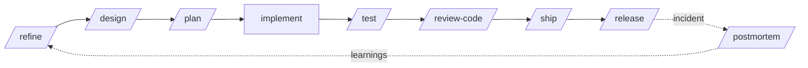

<div align="center">

# 🛠️ Dev Crew

### A complete AI software engineering team for Claude Code

**15 specialist subagents · 21 engineering skills · 14 workflow commands**
The whole SDLC, from a vague ticket to a tagged release.

[](LICENSE)
[](https://github.com/mhrezaee/dev-crew/actions/workflows/validate.yml)
[](https://docs.claude.com/en/docs/claude-code/plugins)
[](CONTRIBUTING.md)

</div>

---

## Why?

Claude Code is great at writing code. Software engineering is more than writing code: refining requirements, designing, planning, testing, reviewing, securing, shipping, releasing and handling incidents.

**Dev Crew** gives Claude a team of senior specialists and the checklists real engineering teams use every day, so you get:

- ✅ **Requirements that are testable** before anyone writes code
- ✅ **Designs with trade-offs and ADRs** instead of "just start coding"
- ✅ **Small, ordered plans** that keep the build green
- ✅ **Tests and reviews by default**, not as an afterthought
- ✅ **Security, performance and operability** built in
- ✅ **Language-agnostic**: .NET, Java/Kotlin, TypeScript, Python, Go, Rust, Flutter, Swift and more. Every agent follows *your* codebase's conventions first

## ⚡ Quick start

### Option 1: Claude Code plugin (recommended)

```bash
# inside Claude Code
/plugin marketplace add mhrezaee/dev-crew
/plugin install dev-crew@dev-crew
```

### Option 2: install script (copies into `~/.claude`)

```bash
git clone https://github.com/mhrezaee/dev-crew.git
cd dev-crew
./install.sh            # macOS / Linux / Git Bash
# or
./install.ps1           # Windows PowerShell
```

Use `--project` / `-Project` to install into the current repository's `.claude/` folder instead, so the whole team gets it via git.

### Try it

```
/onboard                         # understand the repo you're in
/feature Users can export their bookings as CSV
/fix-bug NullReferenceException in InvoiceService.Calculate when discount is null
/review-code main
/ship PAY-142
/standup
```

## 🔄 The SDLC, covered



## 👥 The crew (subagents)

| Agent | Role | Model |
|---|---|---|
| `product-analyst` | Turns vague requests into user stories + Gherkin acceptance criteria with a readiness score | sonnet |
| `solution-architect` | Options, trade-offs, diagrams, API/data design, ADRs | opus |
| `tech-lead` | Ordered, file-level implementation plan with risks | opus |
| `backend-engineer` | APIs, services, jobs, integrations, with tests | sonnet |
| `frontend-engineer` | UI/mobile with all states, a11y, i18n, responsiveness | sonnet |
| `database-engineer` | Schemas, zero-downtime migrations, query tuning | sonnet |
| `devops-engineer` | CI/CD, Docker, Kubernetes, IaC, observability | sonnet |
| `test-engineer` | Unit/integration/e2e tests, flaky-test triage | sonnet |
| `code-reviewer` | Prioritised, verified review findings with fixes | opus |
| `security-auditor` | OWASP, secrets, dependencies, infra misconfig | opus |
| `debugger` | Reproduce → root cause → regression test → minimal fix | opus |
| `performance-engineer` | Measure-first optimisation with before/after numbers | opus |
| `refactoring-specialist` | Behaviour-preserving refactoring in safe steps | opus |
| `docs-writer` | READMEs, runbooks, API docs, CLAUDE.md, verified against code | sonnet |
| `release-manager` | SemVer, changelog, release notes, release checklist | sonnet |

Claude delegates to them automatically when a task matches, or you can ask directly: *"use the security-auditor on src/auth"*.

## 🧠 Skills (loaded on demand)

| Phase | Skills |
|---|---|
| Requirements & design | `requirements-refinement`, `architecture-decision-records`, `api-design` |
| Build | `clean-code`, `error-handling`, `secure-coding`, `database-migrations` |
| Test | `tdd-workflow`, `writing-tests` |
| Review & debug | `code-review-checklist`, `debugging-playbook`, `refactoring-patterns`, `performance-optimization` |
| Ship & operate | `git-workflow`, `ci-cd-pipelines`, `docker-best-practices`, `observability`, `incident-response`, `dependency-upgrades` |
| Knowledge | `codebase-onboarding`, `technical-documentation` |

Skills use progressive disclosure: only their one-line description sits in context until Claude needs them.

## ⌨️ Commands (workflows)

| Command | What it does |
|---|---|
| `/feature <ticket>` | Full pipeline: refine → design → plan → implement → test → review, with checkpoints |
| `/refine <idea>` | Ticket → user stories, acceptance criteria, open questions, readiness score |
| `/design <topic>` | Options + recommendation + diagrams + ADR |
| `/plan <task>` | Small ordered tasks with files, tests and "done when" |
| `/fix-bug <error>` | Reproduce, root-cause, regression test, minimal fix, review |
| `/test [path]` | Fill test gaps for a module or your current changes |
| `/review-code [base]` | Code review + security review in parallel, sorted by severity |
| `/audit-security [path]` | Full security audit including dependencies, Docker and CI |
| `/refactor <target + goal>` | Safe, test-protected refactoring |
| `/onboard [area]` | Codebase map + verified commands, optional CLAUDE.md |
| `/ship [ticket]` | Lint/test gate, self-review, atomic Conventional Commits, PR description |
| `/release [version]` | SemVer bump, CHANGELOG, release notes, checklist |
| `/postmortem <notes>` | Blameless postmortem with timeline, 5 whys, action items |
| `/standup [since]` | Your stand-up update generated from git activity |

> Installed as a plugin, commands may appear namespaced, e.g. `/dev-crew:feature`.

## 🧩 Customise for your company

1. Copy [`templates/CLAUDE.md`](templates/CLAUDE.md) into your repo and fill it in. Every agent reads your conventions first.
2. Fork and edit any agent or skill. They're plain Markdown.
3. Add company-specific skills (e.g. `skills/our-api-guidelines/SKILL.md`) and they get picked up automatically.
4. Change `model:` in an agent's frontmatter to balance cost and depth.

## 🛡️ Safety by design

- Agents **never** commit, push, tag, publish or force-push without your explicit confirmation.
- Reviewers and auditors are read-only (`tools:` restricted).
- Secrets found during audits are masked in output.

## 📁 Repository layout

```
.claude-plugin/   plugin.json + marketplace.json
agents/           15 subagents
skills/           21 skills (one folder each, SKILL.md)
commands/         14 slash commands
templates/        CLAUDE.md template
scripts/          validate.py: frontmatter linter used in CI
install.sh / install.ps1
```

## 🤝 Contributing

New agents, skills, and language-specific improvements are very welcome. See [CONTRIBUTING.md](CONTRIBUTING.md).

If this saves you time, **please ⭐ star the repo**. It helps others find it.

## 📜 License

[MIT](LICENSE) © Hadi Rezaee
