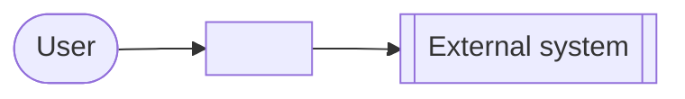
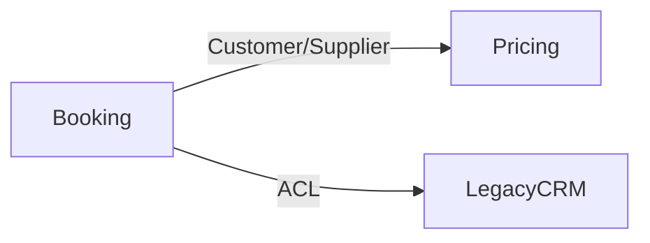

# Architecture Blueprint: <System name>

- Status: Proposed | Accepted
- Date: YYYY-MM-DD
- Owner: <role/team>
- Related ADRs: [0001](../adr/0001-....md), ...

## 1. Context
What the system does, for whom, and the business goals. Context diagram:



## 2. Driver assessment
| Driver | Score (1-5) | Evidence |
|---|---|---|
| D1 Domain complexity | | |
| D2 Team scale | | |
| D3 Independent deployability | | |
| D4 Scale heterogeneity | | |
| D5 Operational maturity | | |
| D6 Consistency needs | | |
| D7 Integration / events | | |
| D8 Read/write asymmetry | | |
| D9 Audit / temporal | | |
| D10 Lifecycle & uncertainty | | |
| D11 Workload shape | | |

Hard constraints: <stack, cloud, compliance, latency, budget, deadline, team skills>

Quality attributes in priority order (top 3 drive trade-offs): e.g. 1. Maintainability 2. Time-to-market 3. Availability

## 3. Decisions at a glance
| Level | Decision | Rejected alternatives (why) |
|---|---|---|
| System topology | e.g. Modular monolith | Microservices (1 team, low ops maturity) |
| Code architecture | e.g. Hexagonal + DDD in `Booking`, vertical slice elsewhere | Clean everywhere (ceremony for CRUD modules) |
| Data | e.g. PostgreSQL, schema per module | DB per module (operational overhead) |
| Integration | e.g. REST for clients, in-process domain events between modules, outbox for external events | Kafka (no streaming need yet) |
| Frontend | e.g. Next.js feature-sliced, React Query | Micro-frontends |
| Testing approach | e.g. TDD for domain, BDD for booking rules, Testcontainers integration, Pact for partner API | |
| Key patterns | e.g. Strategy (pricing rules), Outbox, Specification | Generic repository, Service locator |

## 4. Bounded contexts / modules
| Module | Responsibility | Subdomain type (core/supporting/generic) | Code style | Owns data |
|---|---|---|---|---|

Context map:


## 5. Structure
Folder / project structure with the dependency rule:
```
src/
  Modules/
    Booking/
      Booking.Api/          # public contracts other modules may use
      Booking.Domain/
      Booking.Application/
      Booking.Infrastructure/
  Shared/Kernel/
  Host/
```

## 6. Cross-cutting concerns
AuthN/Z, validation, error handling, logging/tracing, configuration, caching, resilience, i18n, feature flags.

## 7. Fitness functions (enforced in CI)
| Rule | Tool | Test location |
|---|---|---|

## 8. Evolution path & revisit triggers
- Now: ...
- Revisit topology when: e.g. > 3 teams, module X needs independent scaling, deploy queue > 1 day.
- Migration strategy when triggered: e.g. extract module X behind its existing API using strangler fig + outbox.

## 9. Risks & open questions
