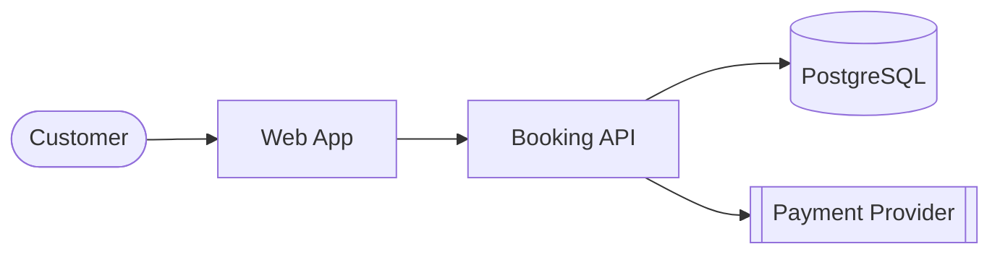

# Technical documentation

## Style
- Lead with what the reader wants to do. Put the most common task first.
- Short sentences, active voice, present tense, second person ("Run `make test`").
- Every command is copy-pasteable and verified. Show expected output when helpful.
- Consistent terminology - define domain terms once in a glossary.
- Diagrams as code (Mermaid) so they are versioned and reviewable.
- Delete stale content; wrong docs are worse than none.

## README template
```markdown
# Project name
One-paragraph description: what it does and for whom.

## Quick start
<prerequisites>
<3-5 commands to get it running>

## Configuration
| Variable | Description | Default |

## Development
build / test / lint / run locally

## Project structure
## Deployment
## Contributing
## License
```

## Runbook template
```markdown
# Runbook: <alert or scenario>
**Symptoms**: what the alert/user sees
**Impact**: who is affected
**Dashboards / logs**: links and queries
**Diagnosis**: 1. check X (`command`) 2. if Y then ...
**Mitigation**: step-by-step, with rollback
**Escalation**: team/channel
```

## Architecture overview
Use C4: Level 1 (system context) and Level 2 (containers) in Mermaid; describe each container's responsibility, tech, and data it owns; link ADRs.



## Code comments
- Doc comments on every public API (XML docs, TSDoc/JSDoc, docstrings, KDoc, GoDoc): purpose, params, returns, errors/throws, example for non-obvious use.
- Inline comments only for *why* (business rule, workaround with ticket link, non-obvious performance choice).
- `TODO(owner, ticket):` never bare TODOs.
